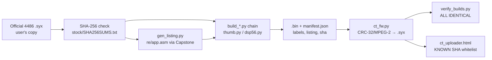

# 01 — Repository audit: CIRCUIT-HACKS-RC

Research phase only. Nothing was flashed, written to an SD card, or sent over MIDI/SysEx.

## Evidence tags used in every document

| Tag | Meaning |
|---|---|
| **[RUN]** | Executed by us in this session, output observed |
| **[STATIC]** | Read in the stock Thumb listing (`re/app.asm`, generated locally from the official image) or decoded from the binary |
| **[EMU]** | Checked by the repository's own Unicorn emulation tests (per its docs/tests; we re-ran only where marked [RUN]) |
| **[HW]** | Reported as tested on a real device in upstream `docs/NOTAS.md` / `PRUEBA.md` (not tested by us) |
| **[DOC]** | Stated in upstream docs only |
| **[HYP]** | Our hypothesis / estimate |
| **[UNK]** | Unknown; see `08-open-questions.md` |

## 1. Revision under investigation

| Item | Value |
|---|---|
| Repository | https://github.com/Ghillermo/CIRCUIT-HACKS-RC |
| Branch | `main` (also `origin/gh-pages`, `origin/copilot/repo-analysis`) — no release tags |
| Commit | `0160e38e6555a35d9768eefdfd7aa66798b7646b` (2026-11-19, "The A7PROT prototype in the installer…") — 93 commits (public repo is re-rooted with `--orphan`, so history is short) |
| Local clone | `~/Personal Repo/circuit-hacks-rc`, our work branch `research/controller-mode` (no commits); `.venv/` and `planning/` excluded via `.git/info/exclude` |
| Firmware baseline | Circuit Tracks **1.2.1 build 4486**. Independently verified **[RUN]**: the file served by Novation Components (`components.novationmusic.com/api/v2/firmwares/168/file`) matches `stock/SHA256SUMS.txt` (`.bin` `b897e0f0…`, `.syx` `bd2d294b…`); stock image = 0x4CDDC B, ends at 0x0805CDDB |
| Release status | **RC4.16 / RC4.16S** = latest published stable candidates; RC4.17/4.17S exist in tree; **Beta 5.56**, **Alpha 7.04** (experimental), **A7.05–7.08** in tree, **A7PROT** = prototype ("untested on the device beyond the install", README) |
| Hardware validation of current RCs | RC4.16/4.17 and A7.05–7.08 are "pendiente de probar" in their `PRUEBA.md` **[DOC]**; A7.04 was exercised as the S704D diagnostic **[DOC/HW]** |

### Toolchain verification [RUN]
- Python 3.12 venv (system Python is 3.15; the pinned wheels `capstone==5.0.7`, `unicorn==2.1.4` were installed into 3.12 to be safe), `tools/setup_dev.py --no-dsptool` (cmake is not installed; the DSP emulator is only needed for DSP tests).
- `tools/patch_official.py … --version r416 | r416s | a7prot` → each `.syx` SHA-256 **identical** to the repository manifest (`a652c1e7…`, `eeac1e55…`, `23eaa125…`). Builds take 3–11 s. The build pipeline is reproducible on macOS/arm64.
- `tools/emu_mixsolo3.py` on A7PROT → `A7PROT MIXSOLO3 RESULT: ALL PASS` (1.5 s). The ARM emulation harness works here.
- Not run: full `tools/run_tests.sh` (~60–90 min, header still describes the SC20 chain), DSP tests (need dsptool/cmake).

## 2. What the project is, architecturally

A **binary-patching toolchain**, not a source fork. Novation's firmware is never redistributed; each version is a Python builder (`tools/build_*.py`, 1 277 files in `tools/`) that loads the user's official image and emits patched bytes. The browser installer (`tools/rc_uploader.html`) does the same patch in-page from the user's `.syx`.

### ARM side (STM32F745, Cortex-M7)
- App at 0x08010000, **max 0x70000 B (physical: STM32F745VE 512 KB, bootloader owns 0x08000000–0x0800FFFF)** — `CLAUDE.md` "Plataforma", NOTAS "Espacio para funciones nuevas" **[DOC/STATIC]**.
- UI, sequencer, MIDI, storage, LED and knob processing all live here. The controller-mode work is ARM-only.
- Code placement mechanisms: append after the stock image end ("cave"), `hole.add` (old DSP program blocks 0x080101F0–0x0801855A freed by repacking), `dspz.add` (gaps left by LZSS-packed DSP programs), `outline.install` (shared subroutines, must be last) — `tools/hole.py:1-20`, `tools/dspz.py:258-318` **[STATIC]**.
- Hooks: (a) repoint a vtable word (`struct.pack_into(..., label|1)`, e.g. `mixsolo.py:95`), (b) `b.w` over a function entry (`srcview.py:357`). Chaining: each new head tail-calls the previous target (`mpatch.bw_target`), installers `assert` the expected previous head (`mixsolo.py:235`).
- Own Thumb-2 assembler `tools/thumb.py` (Capstone-checked encodings). No Keystone, no C compiler in the loop: **every feature is hand-written Thumb in Python**.

### DSP side (Freescale DSP56724, two cores)
- Audio engines, Master FX, drums, granular/FM. Core 1 program at 2047/2048 words (RECURSOS) **[DOC]**. Not needed for a controller mode — see `03-firmware-architecture.md`.

### Hard rules from upstream (`CLAUDE.md` "Reglas") relevant to us
- Never write internal flash / option bytes from our code; never touch the bootloader.
- Never call `MARK_DIRTY` (0x0803BDCC) or anything taking the DSP-service semaphore from the DSP-service tick (permanent lock).
- A new build must not change older ones (`verify_builds.py` → ALL IDENTICAL).
- 6-byte version mark at version block +0x20; two names sharing their first 6 characters won't install over each other.
- Tests must go through the real controller path (0x08033320 / 0x08033282 / 0x08033848), not the guessed handler.
- Shift convention: available Shift shortcuts light yellow `0x2D`; every own mode needs a visible active indicator.

## 3. Subsystems relevant to a controller mode (summary; detail in 03)

| Subsystem | Key addresses (stock 4486) | Evidence |
|---|---|---|
| Controller object `MGR` | 0x20040B10, vtable 0x0805A100 | [STATIC, RUN-verified words] |
| Pad press | vtable slot 0 → `0x08033282(ctrl, pad 0..31, velocity)`; sets bit in held mask `[ctrl+0x84]`; calls active view `[ctrl+0x6C]` slot 0 | [STATIC] |
| Pad release | slot 1 → `0x080332FE` → `0x080332CE(ctrl, pad)` (only if held bit set) → view slot 1 (no velocity) | [STATIC] |
| Button press / release | slot 2 `0x08033320(ctrl, id)` (`tbh` at 0x080333C4) / slot 3 `0x0803381A` | [STATIC] |
| Shift filter | literal at 0x08033DE4 = **0x07DBBE00** (ids allowed with Shift) | [RUN-verified] |
| Knob | slot 4 `0x08033848(ctrl, knob 0..7, signed delta)`; relative ±1 events; drops if `[ctrl+0x7C]` bit 1 (save lock) | [STATIC] |
| LED task | `0x08034196`, 69-halfword frame at `[[MGR+0x90]]`; pads 0–31, Octave 32/33, knobs 34–41 from the active view's slot 7; RGB converter 0x0803423C with 256-entry B,G,R table in RAM at 0x20003804 | [STATIC/EMU/HW partial] |
| Central MIDI send | `0x0803BEDA(port mask, msg ptr)` → router `0x08020C42`; ports 0 USB, 1 DIN/TRS Out, 2 Thru-as-Out2; mask 7 = all | [STATIC, HW via SC06] |
| Template CC send | `0x0804A356(ch, 0xB0, cc, val)` (honours Setup CC Tx filter) | [STATIC/HW] |
| MIDI in dispatcher | `0x08051720`; SysEx in `0x0801EB30`; mod SysEx head catches `F0 7D 43 54 …` | [STATIC/DOC] |
| ms clock | HAL tick `[0x2000081C]` | [STATIC/DOC] |

## 4. Closest working precedents (what we would copy, not reinvent)

| Need | Precedent | Status upstream |
|---|---|---|
| Full-page takeover of pads + releases + knobs + LEDs while sequencer runs | **Master FX** (`build_sc17.py:2427-2484`, wrappers on Mixer vtable 0x0805A668 slots 0/1/4/7) | **[HW]** since SC17.3 |
| View-independent pad intercept | `velcurve.py` heads controller slot 0 | [EMU/DOC] |
| Button-combo head before Shift mask | `srcview c_bentry` at 0x08033320 | [HW for SC19.x line] |
| LED frame override after the task | `leds18.c_ledtask` (`leds18.py:41-55`), `packio.LED_CALLS` chain | [EMU/HW] |
| Hold/tap timing | `pghold` (500 ms), `mfxhold`, `mixsolo3` pad 15 (release by polling `[MGR+0x84]`) | [EMU] only |
| Emit raw MIDI from a pad press | **SC06 patch flip** (`[0xC0|ch, note]` via `0x0803BEDA(7)`) | **[HW]** |
| Knob → CC/NRPN from mod code | SC25 `c_vcc_emit` (`vcf21.py:3023-3040`) | **[HW]** |
| Note remap with guaranteed matching note-off | `gmdrum.py` (stores sounding note) | [EMU] |
| Own SysEx command channel | `rdiag` / `fwid` / black box `F0 7D 43 54 …` (`blackbox.py:21-24`) | [HW diag] |
| Knob LED colour+brightness for own values | `persist19.c_ledhook` at converter 0x080342B0 | [EMU/HW] |

## 5. Current resource situation (the decisive finding)

Flash free = 0x70000 − manifest `image_size` **[RUN]**:

| Build | Image | Free |
|---|---|---|
| Stock 4486 | 0x4CDDC | **143 908 B** |
| RC4.16 / RC4.16S | 0x6F73C / 0x6F72C | **2 244 / 2 260 B** |
| RC4.17 / RC4.17S | 0x6F7A8 / 0x6F798 | 2 136 / 2 152 B |
| A7.08 | 0x6FBB0 | 1 104 B (+58 B in holes) |
| A7PROT | 0x6FD98 | **616 B** |

ARM RAM: heap margin **4 B**; the "~43 KB above the heap" is now densely packed by mod modules (`MXR 0x20045000…`, FM, morph, black box 0x2004F000, knobhold 0x2004F900…), documented gaps ≤ ~126 B each; candidate homes for a 200–600 B block are the 4 KB backup SRAM at 0x40024000 or free ITCM 0x14C8–0x18A3 (RECURSOS) **[DOC]**, both to be confirmed with the upstream canary tool `tools/memmap.py` on a diagnostic build. Global settings tail: 0 B free. Per-project mod bytes: ~7 bits.

**Implication:** a ~2.5–3.5 KB controller module **does not fit any current RC or Alpha** without upstream's not-yet-built space plan (cold code compressed into ITCM ≈ 2 KB net, then QSPI NOR; table compression ≈ 2–3 KB) — `CLAUDE.md` "Sitio en la flash cuando haga falta" **[DOC]**. On the stock image it fits with >140 KB to spare.

## 6. Improvements we found in the upstream project

Ordered by value to the upstream maintainer; all are suggestions, none were applied.

1. **Flash is exhausted and features are not separable.** Every RC is one monolithic chain; users cannot trade a feature they don't use (e.g. FM-8, wavetable, granular) for one they need. A **feature-profile builder** (choose modules in `rc_uploader.html`; verify each profile's SHA like today) would both relieve the flash crisis and make room for niche features like ours without upstream carrying them. This is the single most useful structural change.
2. **No central RAM allocation registry.** RAM above the heap is allocated by convention across dozens of modules; the docs disagree on what's free (`RECURSOS.md:13` "stay below 0x2004F000" vs black box/knobhold/fxstep living at 0x2004F000–0x2004FB8x; `NOTAS.md:58` "not free" vs SC44.2 "≈44 KB free"). A single `ramplan.py` table asserted by `verify_builds.py` (no overlaps, all inside measured-free ranges) would prevent the next silent collision.
3. **Hardware validation lags far behind builds.** 591 firmware directories, the published RC (RC4.16) is "pendiente de probar". A short, scripted **hardware smoke checklist per RC** (the repo has `docs/CHECKLIST.md`; tie each RC's `PRUEBA.md` to it with pass/fail and date) would make "RC" mean something.
4. **Documentation drift** (each verified by us or the sub-traces):
   - English README announces "RC4.11, Beta 5.56 and Alpha 7.01" (`README.md:150`) while the Spanish header says RC4.16 / A7.04 (`README.md:22`).
   - README says A7PROT = Alpha 7.04 + …; `firmware/a7prot/PRUEBA.md` says Alpha 7.07 + `mixsolo3`.
   - `CLAUDE.md` "LEDs": "no RGB table in the image" — the table exists in RAM at 0x20003804 (NOTAS:3830); NOTAS itself gives two byte orders (R,G,B at :3830, corrected to B,G,R at :975/:1240).
   - `CLAUDE.md` Shift-dropped list omits id 18 (mask bit 18 is 0); "Shift + ids 0–8 do nothing" is true only for stock.
   - `build_sc17.py:76` labels 0x0805A5F0 as the Mixer vtable; it's view id 1 (Mixer is 0x0805A668).
   - `leds18.py:7-9` calls LED 48 "1-16/17-32" (it is Record; the page LED is 53).
   - `tools/run_tests.sh` header still describes the SC20 chain.
5. **Context-file size.** `CLAUDE.md` is ~300 KB (lines of several KB each) — far beyond what an assistant can load usefully; split into a short index + per-subsystem notes (`docs/arch/*.md`), keep release history in `CHANGELOG.md`.
6. **Repository weight.** 724 MB of `firmware/*/manifest.json` (1.7–2.2 MB each, mostly listings) + 193 MB `.git`. Manifests could store a hash of the listing and keep full listings as release assets.
7. **No CI.** No `.github/`. A GitHub Action that runs `verify_builds.py` (needs the official image: use a self-hosted runner or a secret-fetched copy that is never published) plus the quick ARM tests would catch regressions before publishing.
8. **Python version note.** Setup says "Python 3.10+"; the pinned wheels are the real constraint. We used 3.12; a `.python-version` / note on the newest tested interpreter would help (we did not test 3.15).
