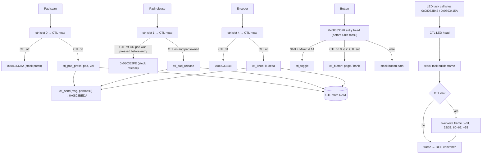

# 03 — Proposed firmware architecture: "CTL" controller overlay

All addresses are stock 4486. On a CIRCUIT-HACKS base the same entry points are already headed by other modules, and CTL must chain onto them (see §7).

## 1. Design choice: overlay at the controller, not a new view

Upstream has **no precedent for adding a new view object or cloning a vtable**. Every mod mode is an overlay behind a RAM flag (srcview, SPLIT, modesel/flipview, Master FX, mixsolo3) **[STATIC/DOC]**. Two overlay levels exist:

| Level | Example | Pros | Cons |
|---|---|---|---|
| Per-view vtable wrapper | Master FX on Mixer vtable 0x0805A668 slots 0/1/4/7 **[HW]** | Hardware-proven; the LED buffer comes for free via slot 7 | Only works while that view is active; entering means switching view |
| **Controller vtable heads** (0x0805A100 slots 0/1/4, button entry 0x08033320 / 0x0803381A, LED-task call sites) | velcurve (slot 0), srcview `c_bentry`, leds18/packio LED chain **[STATIC/EMU]** | Independent of the active view. The underlying view, its state and the sequencer are untouched | Composes several precedents that are each proven separately but not proven together |

**Recommendation: controller-level overlay.** Entering CTL **does not call the view switch `0x0803390C`** (that path can `sleep` for a store flush, NOTAS:4248). The active view `[ctrl+0x6C]` stays whatever it was, so leaving CTL drops the user back exactly where they were, and nothing the sequencer depends on changes.

## 2. Event flow



### Press path detail
`0x08033282(ctrl, pad, vel)` first checks the save-lock bit `[ctrl+0x7C]` bit 1, then sets bit `pad` in `[ctrl+0x84]` and calls view slot 0 **[STATIC]**. The CTL head:
1. Honours the same save lock: if the lock bit is set, it drops the press, as stock does.
2. Does **not** set the stock held bit. As a result, the stock release `0x080332CE` will ignore the pad, because it only acts if the held bit is set.
3. Sets its own `ctl_held` bit, looks up the action for `(page, pad)`, builds and sends the press message, and stores the **release record** (the exact bytes to send on release) for that pad.

### Release path detail
- If the stock held bit is set, the pad was pressed before CTL was entered: forward the release to stock so the view gets a matching release. This prevents stuck notes in the underlying view.
- Else, if the `ctl_held` bit is set: send the stored release record and clear the bit. The record is used rather than re-reading the config, so a page change while the pad is held cannot produce a mismatched note-off.

### Knob path
Events are relative, about ±1 per event, with no acceleration **[STATIC; NOTAS:2981 HW bug report]**. CTL keeps `val[bank][k]` (0..127, clamped), applies an optional divisor, and sends the CC only when the clamped value changes. That way a fast turn produces at most one message per event per knob.

## 3. MIDI message generation

| Message | Bytes | Send primitive |
|---|---|---|
| Note On / Off | `9n kk vv` / `8n kk 00` (or `9n kk 00`, see open question Q4) | `0x0803BEDA(mask, ptr)` |
| CC | `Bn cc vv` | same |
| Program Change | `Cn pp` | same (SC06 precedent sends `[0xC0\|ch, note]` this way **[HW]**) |

- `0x0803BEDA` calls a gate `0x080223FA` and then tail-calls the router `0x08020C42(router [0x200069F4], mask, msg)` **[STATIC]**.
- Port mask bits: 0 = USB, 1 = DIN/TRS Out, 2 = Thru jack when configured as Out 2.
- To verify before coding (Q1/Q2 in 08): the exact msg-pointer format and how length is determined, what the gate tests, and whether the call is safe re-entrantly from the UI task while the sequencer thread sends.
- **Deliberately not used:**
  - the stock transmitter vtable 0x08059FC4/C8 (note path), because it applies the track channel and Note-Tx filter and is shared with the sequencer;
  - `0x0804A356`, because it applies the Setup CC-Tx filter and SC05 internal loopback.

  CTL output is a separate stream with its own enable, so the user's Setup filters for the sequencer stay meaningful. This conflicts with stock filter semantics; see decision D3 in `08`.
- **Throughput:** sends from the UI task are cut at 64 messages per press **[HW-observed, RECURSOS:230]**. v1 sends 1 message per event.

## 4. LED rendering

- Frame: 69 halfwords at `[[MGR+0x90]]`, built by task 0x08034196 **[STATIC]**.
  - Entries 0–31 are pads, 32/33 Octave ▼/▲, and 34–41 map to knob LEDs 60–67; all of these come from the active view's slot 7.
  - LED 53 (1-16/17-32), Record 48, Play 49, Clear 55 and Duplicate 56 come from fixed objects.
- CTL paints **after** the stock task, in the `leds18.c_ledtask` style: it chains the call sites, calls the original, then `strh` into the frame. CTL therefore owns its LEDs without replacing any view's slot 7.
- Colours are palette codes (< 0x100) looked up in the RAM table 0x20003804 (B,G,R). Families of four exist: steady, dim, blink, pulse. **35 entries animate natively [HW]**, so CTL gets blinking with no timer.
- Knob LEDs:
  - Stock "static" codes give a fixed colour.
  - Brightness proportional to value needs the converter hook at 0x080342B0, as `persist19.c_ledhook` does: high byte = brightness. On a stock base we would carry a minimal copy of that hook (≈60–100 B, [HYP]).
- Cost: a 32 + 10 halfword overwrite per frame, roughly 100 instructions. It runs on the LED task's stack, which is tight: a 1840 B stack depth reset the unit, and 1792 B is safe [HW, issue #22]. CTL's LED head must use ≤ 16 B of stack and no calls.
- The frame rate is [UNK] on hardware. Emulation samples every 10 ms.

## 5. State

```c
// ≈ 64–200 B RAM [HYP]; placement: see 05 / 08-Q7
struct ctl_state {
  u32 sig;            // 'CTL1' guard against stale RAM
  u8  on, page, bank, flags;
  u32 held;           // pads owned by CTL
  u32 toggles[3];     // toggle state per page (locally commanded)
  u8  rel[32][3];     // release record per pad: status, d1, d2 (status 0 = none)
  u8  val[4][8];      // knob values per bank
};
// config (flash, const, baked at build time): 3 pages × 32 pads × 8 B + 4 banks × 8 knobs × 6 B ≈ 960 B
```

## 6. Mode transitions

```mermaid
stateDiagram-v2
  [*] --> Off
  Off --> On: Shift + Mixer (id 14)
  On --> Off: Shift + Mixer
  On --> Off: any view/track button (0–8, 13, 15, 18, 26) — then the button acts normally
  On --> Off: project/pack load hook (persist19.LOAD_END precedent) — no LED/flag leftovers
  On --> On: Octave ▼/▲ = page, 1-16/17-32 = knob bank
  note right of Off: Exit always flushes: send every rel[] record, clear held
```

- **Sequencer:** untouched. Play, Record, Tempo, Clear and Duplicate pass straight through in CTL. What pads do inside Clear/Duplicate is undefined, so CTL ignores pads while Clear or Duplicate is held.
- **Shift + Mixer is free in stock:** bit 14 of the Shift mask 0x07DBBE00 is 0, so stock drops it **[RUN-verified]**. The mod also leaves it unused, except for the superseded SC17.2 `ENTRY="shift"` (build_sc17.py:75). Fuzz-confirm this before relying on it (see `06`).
- **Indicator:**
  - The pad page is visually distinct.
  - The Octave LEDs show the page.
  - LED 53 shows the bank colour.
  - Holding Shift lights the Mixer button yellow 0x2D, per house convention. Whether CTL can drive the Mixer button LED is [UNK]: it is not in the view-owned set.

## 7. Integrating with CIRCUIT-HACKS instead of stock

The entry points CTL needs are already headed in RC/Alpha:
- the controller slot 0 head is `velcurve`;
- the button entry is `srcview c_bentry` plus a chain (dbtoggle, mfxhold, …);
- the LED call sites go through `packio.LED_CALLS` (clickflash, autorel, patchain, knobhold, …);
- the knob path goes through knobhold.

CTL would be installed as the **outermost head** of each. It must pass everything through untouched when off, and in that state `emu_sc19_fuzz.py`-style differential tests should show zero state difference.

Two blockers on that base:
- **Flash:** 616 B to 2.2 KB is free versus ≈2.5–3.5 KB needed.
- **RAM:** there is no free ≥ 200 B block in the documented map.

So the first CTL builds target the **stock image**, reusing the upstream toolchain (`thumb.py`, `ct_fw.py`, the emulators). This follows upstream's own early pattern (`build_sc03.py`, 235 lines: code cave after 0x0805CDDC, six hooks).

## 8. Why no DSP work

All inputs (pads, knobs, buttons), LEDs and MIDI output are ARM-side. CTL never writes the DSP, never runs in the DSP-service tick, and takes no semaphore. The `MARK_DIRTY` hazard does not arise, because CTL changes no project data.
