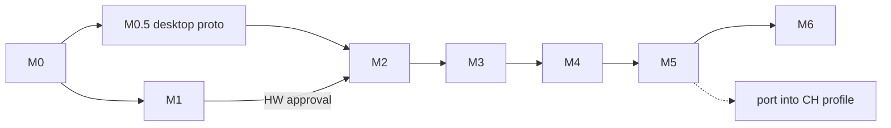

# 07 — Implementation roadmap

No firmware patches are written until M0 is reviewed. Every hardware step needs explicit approval at the time.

## M0 — Technical audit ✅ (this document set)

- **Done:**
  - Revision pinned.
  - Toolchain reproduced byte for byte (RC4.16, RC4.16S, A7PROT) [RUN].
  - ARM harness runs [RUN].
  - Input, LED, knob and MIDI paths traced [STATIC].
  - Flash budget measured [RUN].
- **Go/no-go:**
  - **Go** for a stock-based CTL prototype.
  - **No-go** for adding to current RC/Alpha until there is ≥ 4 KB of room and ≥ 256 B of RAM there.

## M0.5 — Desktop interaction prototype (Option A), 2–4 evenings

- **Tasks:**
  - TypeScript + Web MIDI page, strict mode, per house defaults. It reads Circuit MIDI-track notes and maps them to the `09` contracts toward the Bitbox, VE-500 and Pro-800.
  - Measure what each device really accepts (Q11–Q16).
- **Deliverable:** a verified device contract table, which replaces the provisional values in `09` §3.
- **Go/no-go:** each v1 pad action is confirmed on its target device, or that action is dropped.

## M1 — Proof of pad → MIDI (stock base, emulation only)

- **Depends on:** M0.
- **Tasks:**
  1. Resolve Q1–Q3 by static reading plus a small emulation probe:
     - `0x0803BEDA` message format;
     - the gate at `0x080223FA`;
     - the send call graph.
  2. `tools/build_ctl.py` (in our fork): stock + cave + controller slot 0/1 heads + the Shift+Mixer head at `0x08033320`. Hard-coded single page of 32 gate notes.
  3. `emu_ctl.py`: T-PAD-1/6/7, T-ENT-1/2/3, T-STK-1/3, T-FUZ-1, T-BLD-1.
- **Accept:**
  - All of the above pass.
  - CTL off is state-identical to stock under fuzz.
  - The build is reproducible.
- **Go/no-go to hardware:**
  - T-FUZ-1 is clean.
  - The user has approved the first install (T-HW-0, HW-1, HW-9, HW-3 subset).

## M2 — Native 32-pad controller

- **Depends on:** M1, plus hardware confirmation that the sequencer keeps playing (T-HW-2).
- **Tasks:**
  - Action types: gate note, fixed-velocity note, CC momentary, CC toggle, PC.
  - Per-pad channel and port mask.
  - 3 pages on Octave ▼/▲.
  - Release records.
  - Flush on exit, page change and project load.
  - Palette LEDs per `09` §5.
- **Tests:** all T-PAD, T-CH, T-PG, T-LED-1/3, T-STK, T-FUZ-2, T-STACK-1. Hardware: HW-2/3/4/8.
- **Accept:**
  - No stuck notes in any test.
  - Playback is uninterrupted across 50 entries/exits.
  - Latency is no worse than a stock MIDI-track pad.
- **Risks:** R4, R5, R6, R8.

## M3 — Encoder banks

- **Depends on:** M2.
- **Tasks:**
  - 4 banks × 8 CCs (absolute, 0–127, min/max, channel, port).
  - Bank selection on 1-16/17-32.
  - Optional divisor.
  - Bank colour on knob LEDs. Value brightness needs a minimal converter hook (port of `persist19.c_ledhook`).
- **Tests:** T-KNB-*, T-LED-2, T-SAT-1. Hardware: HW-5/6.
- **Accept:**
  - Values are retained per bank.
  - No message on bank switch.
  - Clock jitter is within threshold.

## M4 — LED state and external feedback

- **Tasks:**
  - Blink/pulse families for "momentary held" and "armed".
  - Custom SysEx `F0 7D 43 54 <CTL cmd>`:
    - set pad colour;
    - set knob value;
    - query version.
  - Optional feedback channel (note = pad, velocity = palette code).
  - Distinguish locally commanded from externally confirmed state, e.g. confirmed = steady and commanded-only = dim variant.
- **Tests:** T-SYX-1, LED tests extended.
- **Accept:** malformed input never corrupts state. No feedback loop with the Thru5 / USB merge wiring.

## M5 — Configuration persistence + editor

- **Step 1 (low risk):**
  - The browser editor (TypeScript, Web MIDI) produces the template.
  - The template is **baked into the image at patch time**, like `rc_uploader.html` patches today. There is no runtime persistence. Changing the template means reinstalling, which takes about 1–2 minutes.
- **Step 2:**
  - Load a template over SysEx into RAM (volatile).
  - Then decide on persistent storage: a file on volume 0 or the SD through the storage API (`0x0803CA52`), or the backup SRAM. Decision D4.
  - This requires understanding checksums and failure modes first. Never use the stock MIDI-template store, because it is shared with MIDI tracks and Components.
- **Port to CIRCUIT-HACKS:**
  - Propose a feature-profile build upstream, or wait for the ITCM/NOR space plan.
  - Chain CTL as the outermost head.
  - Run the upstream suite plus differential fuzz.

## M6 — Live hardening

- **Tasks:**
  - T-HW-7: 30 min sessions × 5.
  - Power-cycle in mode.
  - Cable pulls.
  - Clock-source changes: internal, DIN, USB.
  - Project/pack changes under load.
  - Stage-light legibility.
  - A one-page performance cheat sheet.
- **Accept:** zero stuck notes and zero playback glitches across all sessions. Every failure is reproduced in emulation or explained.

## Dependency graph

